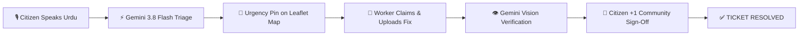

<p align="center">
  
</p>

<h1 align="center">آواز — Awaaz</h1>

<p align="center">
  <strong>Next-Gen Voice-First Civic Hazard Reporting & AI Vision Verification for Pakistani Cities</strong><br>
  <em>Piloted in Islamabad • Powered by Google Gemini 3.8 Flash • Built for Real Citizens</em>
</p>

<p align="center">
  
  
  
  
  
  
</p>

---

## 🏛️ What is Awaaz?

**Awaaz (آواز)** is a mobile-first civic accountability ecosystem designed to bridge the chasm between Pakistani citizens and municipal governance (such as the CDA, IESCO, WASA, and SNGPL).

Everyday citizens walking through commercial markazes and neighborhoods dodge hazardous open manholes, dangling 220V power lines, monsoon sewage backups, and heaps of uncollected garbage. Existing grievance portals (e.g. Pakistan Citizen Portal) suffer from high language friction, mandatory English forms, complex department routing, and the notorious **"Ghost Closure Loop"** — where contractors falsely mark complaints as *"Resolved"* to hit performance quotas without doing the actual physical work.

**Awaaz fundamentally changes this dynamic:**
1. **Zero-Friction Urdu Voice Intake:** Citizens speak naturally in conversational Urdu (like sending a WhatsApp voice note).
2. **Instant AI Triage:** Gemini 3.8 Flash translates, extracts landmarks, categorizes the department, assesses urgency, and drops a geocoded pin on the live map in under 3 seconds.
3. **AI Vision Anti-Fraud Verification:** Workers must submit an "After" repair photo; Gemini Vision compares the Before vs. After condition to detect fraudulent closures.
4. **Citizen Sign-Off:** A ticket is **only** fully resolved when the community taps **"+1 Confirm Fix"**.

---

## 🌟 The Golden Path (Core Flow)



1. **Citizen Ingestion:** Citizen taps the mic button and speaks in Urdu:
   > *"F-10 markaz mein road ke corner pe gutter ka dhakkan toota hua hai, paani nikal raha hai aur raat ko haadsa ho sakta hai."*
2. **AI Triage Card:** Gemini 3.8 Flash parses the audio stream, outputs Urdu transcript, English summary, department chip (`CDA_SANITATION`), and priority badge (`CRITICAL`), auto-pinning the coordinates to the interactive Leaflet map.
3. **Worker AI Verification:** The field contractor (Sajid) claims the ticket in the Worker Portal, completes the repair, and uploads an "After" photo. Gemini Vision runs on-screen Before/After comparison to ensure legitimate resolution.
4. **Citizen Sign-Off:** The citizen visits *My Reports* and taps **"+1 Confirm Fix"**, turning the ticket vibrant green (`RESOLVED`).

---

## 🚀 Key Features

- **🎙️ Conversational Intake (Home Tab):** Live `MediaRecorder` audio capture with real-time waveform visualizer, 30s timer, photo attachment (`➕`), and text fallback.
- **🗺️ Interactive Islamabad Map:** Vanilla Leaflet integration with custom SVG pins (🔴 Critical, 🟠 High, 🟡 Medium, 🟢 Resolved) centered on key Islamabad sectors (F-10, F-6, G-9, I-9).
- **📰 Community Feed (Explore Tab):** Upvote/downvote voting, flat Instagram-style discussion comments, and sector-based filtering.
- **👷 Dedicated Worker Portal:** Prioritized dispatch queue, route navigation, and instant Before/After vision verification.
- **🏛️ Mayor / Executive Command Desk:** Sector-level Civic Health scorecards and contractor performance audit desk.
- **🔄 Role Switcher:** Instant top-bar switcher between **Tariq** (Citizen, F-10), **Ayesha** (Citizen, F-6), **Sajid** (Field Contractor), and **Comm. Nasir** (Mayor).
- **📡 Offline Resilience:** Built-in deterministic `<300ms` fallback mock and an "Offline Mode (Synced locally)" badge ensuring zero demo freezes on patchy network connections.

---

## 🛠️ Tech Stack

| Layer | Technology |
|---|---|
| **Framework** | [Next.js 15 (App Router)](https://nextjs.org/) + React 19 |
| **Language** | TypeScript (Strict mode) |
| **Styling** | [Tailwind CSS v3.4](https://tailwindcss.com/) + [Lucide React](https://lucide.dev/) Icons |
| **Mapping** | [Leaflet](https://leafletjs.com/) (SSR-safe dynamic import with custom inline SVG markers) |
| **AI Models** | [Google Gemini 3.8 Flash](https://ai.google.dev/) via `@google/genai` (Server-side routes) |
| **Validation** | [Zod](https://zod.dev/) Schema Enforcement |
| **State & Storage** | React Hooks + Hydration-safe `localStorage` with pre-seeded Islamabad complaint data |

---

## 🏁 Quickstart & Installation

### 1. Prerequisites
- [Node.js](https://nodejs.org/) v18.18.0 or newer
- `npm` v9 or newer
- (Optional) [Google AI Studio Gemini API Key](https://aistudio.google.com/) for live Gemini calls. (A deterministic fallback works automatically if no key is provided).

### 2. Clone and Install
```bash
git clone https://github.com/taimoorahmadx/awaaz.git
cd awaaz
npm install
```

### 3. Configure Environment Variables
Copy `.env.example` to `.env.local`:
```bash
cp .env.example .env.local
```

Add your Gemini API key in `.env.local`:
```ini
GEMINI_API_KEY=your_gemini_api_key_here
```

### 4. Run Development Server
```bash
npm run dev
```

Open [http://localhost:3000](http://localhost:3000) in your browser (mobile view `max-w-md` is recommended).

### 5. Production Build
```bash
npm run build
npm run start
```

---

## 📁 Repository Structure

```
├── app/                          # Next.js 15 App Router pages and API routes
│   ├── api/analyze-audio/        # Server-side Urdu audio & text Gemini triage
│   ├── api/verify-fix/           # Server-side Gemini Vision Before/After verification
│   ├── layout.tsx                # Mobile shell wrapper (max-w-md mx-auto)
│   └── page.tsx                  # Main 5-tab application controller
├── components/                   # Modular UI components
│   ├── audio/                    # Waveform visualizer & audio recorder
│   ├── common/                   # Header, Role switcher, Offline status badge
│   ├── feed/                     # Complaint cards, Reddit-style votes, Comments
│   ├── home/                     # Conversational Awaaz Bot intake bar
│   ├── map/                      # SSR-safe Leaflet map & slide-over details drawer
│   ├── worker/                   # Worker dispatch queue & Before/After vision cockpit
│   ├── mayor/                    # Executive governance dashboard
│   └── reports/                  # My Reports lifecycle stepper & community sign-off
├── docs/                         # Spec-driven context & development documentation
│   ├── brief.md                  # Project brief, user persona & product narrative
│   ├── spec.md                   # EARS-compliant technical specification
│   ├── plan.md                   # Architectural blueprints & data schemas
│   ├── tasks.md                  # Granular sprint backlog with verification criteria
│   └── progress.md               # Live project progress & forensic bug tracker
├── lib/
│   ├── ai/                       # Gemini SDK client, prompts, Zod schemas, offline mocks
│   ├── data/                     # 12 pre-seeded Islamabad complaints & local storage hook
│   └── types.ts                  # Shared TypeScript interfaces & domain models
└── public/
    └── images/hazards/           # Offline-safe local hazard Before/After photography
```

---

## 📖 Development & Spec-Driven Workflow

Awaaz follows strict spec-driven development guidelines outlined in [`AGENTS.md`](AGENTS.md):
- **Sprint 1 (Completed):** Scaffold, Leaflet map with SVG pins, seed data, and explore feed.
- **Sprint 2 (Completed):** Gemini 3.8 Flash routes, Home voice intake, Worker verification, and Mayor shell.
- **Sprint 3 (Current):** Schema harmonization, confidence display normalization, native photo upload, detail modals.
- **Sprint 4 (Planned):** Hyper-local neighborhood chat groups, proximity duplicate merging, and live mayor actions.

---

## ⚖️ License
Built with ❤️ for civic empowerment in Pakistan. Distributed under the [MIT License](LICENSE).
