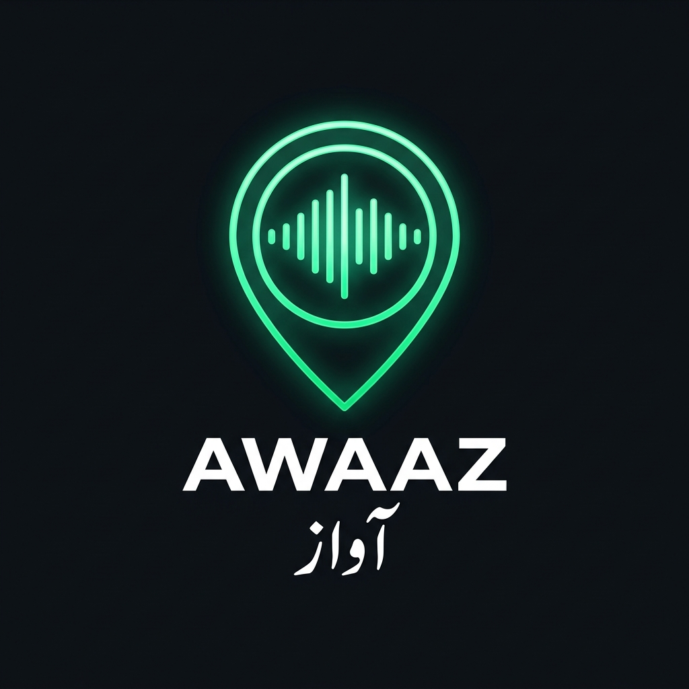
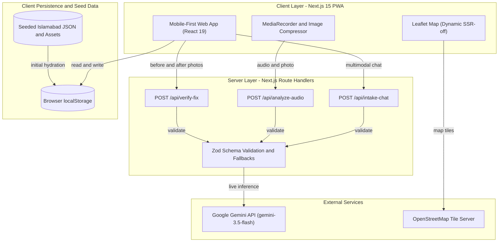
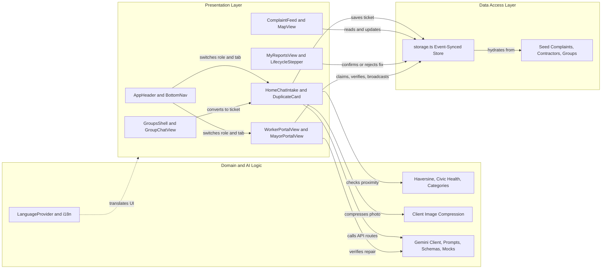

<p align="center">
  
</p>

<h1 align="center">آواز — Awaaz</h1>

<p align="center">
  <strong>Voice-First Civic Accountability &amp; AI-Verified Municipal Governance</strong><br />
  <em>Speak in Urdu, Roman Urdu, or English — triage civic issues with Gemini, verify repairs with Vision AI, and hold city services accountable.</em>
</p>

<p align="center">
  
  
  
  
  
  
</p>

---

## What is Awaaz?

**Awaaz (آواز)** is a mobile-first civic accountability and municipal governance PWA built for Pakistani cities (piloted in Islamabad across CDA, IESCO, WASA, and SNGPL jurisdictions).

Traditional civic grievance portals fail citizens through language barriers, rigid forms, opaque routing, and the **"Ghost Closure Loop"** — where contractors mark tickets as resolved without completing physical work. Awaaz closes that loop end-to-end:

- **Conversational Multilingual Intake:** Citizens report issues via live Urdu/English voice notes, text, or photos in a streaming AI chat that asks clarifying questions and generates an editable ticket draft.
- **Proximity Duplicate Merging:** Location resolution (GPS → Islamabad landmark matching → sector centre) detects nearby open issues within 50m so neighbors can tap **"+1 Impacts Me Too"** and escalate urgency instead of fragmenting reports.
- **Vision-Verified Repairs:** Field workers claim tickets, upload repair photos, and run server-side Gemini Vision Before/After verification before a fix can move forward.
- **Citizen Sign-Off:** A ticket only reaches `RESOLVED` when the citizen confirms the fix (or rejects it back into the queue).
- **Neighborhood Groups & Executive Oversight:** Hyper-local sector channels let residents discuss issues, convert messages into tickets, and receive official `📢 Municipal Alerts` from the Mayor's Command Desk, backed by live Civic Health scorecards and contractor payout freezes.

---

## Core Capabilities

### Citizen Experience
- **Conversational AI Intake (Home):** Multi-turn streaming chat (`/api/intake-chat`) with live `MediaRecorder` waveform visualization, client-side photo compression, editable ticket drafts, and duplicate detection.
- **Interactive Geo Map (Map):** SSR-safe Leaflet map with custom inline SVG urgency pins, sector/status filtering, and slide-over complaint details.
- **Community Feed (Explore):** Upvote/downvote prioritization, flat discussion comments, sector filters, and full ticket lifecycle modals.
- **My Reports (Reports):** Personal ticket tracker with step-by-step lifecycle progress and **"+1 Confirm Fix"** / **"Not Fixed"** citizen sign-off controls.
- **Neighborhood Groups (Groups):** Sector channels (`F-10`, `F-6`, etc.) and read-only `📢 Municipal Alerts`, with one-tap **"Convert to Ticket"** from community messages.
- **Trilingual UI:** Instant switching between **English**, **اردو (Urdu)**, and **Roman Urdu** across citizen, worker, and mayor views.

### Field Worker Portal
- **Prioritized Dispatch Queue:** Filterable by department, with route mini-map and Google Maps navigation links.
- **Before/After Verification Cockpit:** Upload repair photos (or non-visual fix notes) and run server-side Gemini Vision verification with confidence scoring and fail-closed validation.
- **Worker Profile:** Live resolution metrics and active assignment tracking.

### Mayor / Executive Command Desk
- **Dynamic Civic Health Scorecards:** Real-time sector grades (`A`–`F`) computed from open severity, overdue tickets, and resolution rates.
- **Contractor Audit & Payout Freeze:** Inspect department/contractor performance and freeze payouts for underperforming or disputed work.
- **Emergency Broadcasts & Rapid Crew Dispatch:** Publish official alerts directly to `📢 Municipal Alerts` and dispatch rapid response crews.

### Offline & Demo Resilience
- **Deterministic `<300ms` Fallbacks:** Every AI route falls back cleanly on timeout, missing API key, or `AI_FORCE_FALLBACK=1`, surfacing an honest **"Offline Mode (Synced locally)"** indicator.
- **PWA Support:** Installable standalone manifest (`app/manifest.ts`) with self-hosted fonts and local hazard imagery.

---

## Architecture

### Application Architecture

<!-- mermaid-checked: no \n, no em-dash/en-dash, no {} in labels, subgraphs are id["label"], arrows are -->|"label"|, all subgraphs closed by end, ids unique -->


#### Technology Stack Summary

| Layer | Technology | Version | Purpose |
|---|---|---|---|
| **Framework** | Next.js (App Router) + React | `15.5.27` / `19.3.0` | Mobile-first UI shell and server-side API route handlers |
| **Language** | TypeScript (Strict) | `5.9.3` | End-to-end type safety across UI, storage, and AI contracts |
| **UI & Styling** | Tailwind CSS + shadcn/ui + Lucide | `3.4.19` / `2.3.0` | Dark civic theme, accessible Radix primitives, and icons |
| **Mapping** | Leaflet | `1.9.4` | Interactive sector map with SSR-safe dynamic import and SVG pins |
| **AI & Vision** | Google Gemini (`@google/genai`) | `2.28.0` (`gemini-3.5-flash`) | Multimodal intake chat, Urdu audio triage, and Before/After verification |
| **Validation** | Zod | `4.6.5` | Strict runtime schema validation for AI outputs |
| **Testing** | Playwright | `1.64.0` | Chromium E2E verification across citizen, worker, and mayor flows |

#### Data Storage & External Services
Awaaz uses browser `localStorage` hydrated from pre-seeded Islamabad JSON datasets (`seedComplaints.json`, `seedContractors.json`, `seedGroups.json`, and `landmarks.json`) so all tabs and portals stay synchronized without a remote database. Server-side Next.js route handlers communicate with the Google Gemini API (`GEMINI_API_KEY`) for multimodal triage and vision verification, while Leaflet fetches map tiles from OpenStreetMap.

#### Key Architectural Decisions
- **Server-Side AI Isolation & Fail-Closed Verification:** All `@google/genai` calls execute strictly inside `app/api/*` Node.js route handlers; verification responses are parsed with Zod and fail closed to deterministic fallbacks (`isOfflineFallback: true`) if malformed or timed out.
- **Event-Synchronized Client Store:** `lib/data/storage.ts` dispatches custom change events on every mutation, keeping Map, Feed, My Reports, Groups, Worker, and Mayor views reactive in real time.
- **Client-Side Media Compression:** Photos are resized and JPEG-compressed (`lib/image.ts`) before persisting to `localStorage` to prevent quota exhaustion.

---

### Component Relationships

<!-- mermaid-checked: no \n, no em-dash/en-dash, no {} in labels, subgraphs are id["label"], arrows are -->|"label"|, all subgraphs closed by end, ids unique -->


#### Component Inventory

| Component | Layer | Type | Responsibility |
|---|---|---|---|
| `AppHeader` / `BottomNav` | Presentation | Navigation Shell | Role switcher (Tariq, Ayesha, Anonymous, Sajid, Comm. Nasir), language switcher, offline badge, and 5-tab citizen navigation |
| `HomeChatIntake` / `DuplicateCard` | Presentation | Citizen Intake | Multi-turn voice/text/photo intake chat, editable ticket drafts, and 50m proximity duplicate confirmation |
| `ComplaintFeed` / `MapView` | Presentation | Discovery & Geo | Filterable community feed, voting/comments, detail modal, and Leaflet map with custom SVG pins |
| `GroupsShell` / `GroupChatView` | Presentation | Community | Sector chat channels, complaint embeds, `📢 Municipal Alerts`, and "Convert to Ticket" handoff |
| `MyReportsView` / `LifecycleStepper` | Presentation | Accountability | Citizen report tracking and final "+1 Confirm Fix" / "Not Fixed" resolution sign-off |
| `WorkerPortalView` / `MayorPortalView` | Presentation | Role Portals | Worker dispatch queue, Before/After vision verification, sector Civic Health scorecards, contractor freezes, and broadcasts |
| `LanguageProvider` / `i18n.ts` | Domain | Localization | EN / اردو / Roman Urdu translation context across all portals |
| `lib/utils.ts` / `lib/categories.ts` | Domain | Business Logic | Haversine distance, location resolution, Civic Health grading, and fixed category-to-department mapping |
| `lib/image.ts` | Domain | Media Utility | Client-side image resizing and JPEG compression for `localStorage` safety |
| `lib/ai/*` | Domain | AI Integration | Gemini SDK initialization, timeouts, prompts, Zod schemas, verification rules, and `<300ms` offline mocks |
| `lib/data/storage.ts` | Data Access | State Store | Hydration-safe `localStorage` persistence with event broadcasting and seed initialization |

---

## 📸 UI Preview

> Add screenshots of the mobile UI (`max-w-md` viewport) below to showcase each role and workflow.

| Citizen Intake & Map | Community Groups |
| :---: | :---: |
| <!-- Replace with:  --> *Add screenshot: **Home Conversational Intake** (voice/chat + ticket draft)* | <!-- Replace with:  --> *Add screenshot: **Groups Tab** (sector channel + Municipal Alerts)* |

| Worker Vision Verification | Mayor Command Desk |
| :---: | :---: |
| <!-- Replace with:  --> *Add screenshot: **Worker Portal** (Before/After AI verification)* | <!-- Replace with:  --> *Add screenshot: **Mayor Portal** (Civic Health scorecard & contractor audit)* |

---

## Quickstart & Installation

### 1. Prerequisites
- [Node.js](https://nodejs.org/) `v18.18.0` or newer
- `npm` `v9` or newer
- *(Optional)* [Google AI Studio Gemini API Key](https://aistudio.google.com/) for live Gemini calls (deterministic offline fallbacks work automatically without a key)

### 2. Clone & Install
```bash
git clone https://github.com/taimoorahmadx/awaaz.git
cd awaaz
npm install
```

### 3. Configure Environment Variables
```bash
cp .env.example .env.local
```

Edit `.env.local` as needed:
```ini
# Required for live AI calls (server-side only)
GEMINI_API_KEY=your_gemini_api_key_here

# Optional overrides
# GEMINI_MODEL=gemini-3.5-flash
# AI_TIMEOUT_MS=12000
# AI_FORCE_FALLBACK=1
```

### 4. Run Locally
```bash
npm run dev
```
Open [http://localhost:3000](http://localhost:3000) in your browser (a mobile viewport is recommended).

### 5. Build & Lint
```bash
npm run build
npm run lint
```

---

## Repository Structure

```text
├── app/                          # Next.js 15 App Router pages, manifest, and API routes
│   ├── api/intake-chat/          # Multi-turn conversational AI intake & draft generation
│   ├── api/analyze-audio/        # Audio, text, and photo triage route
│   ├── api/verify-fix/           # Before/After Gemini Vision repair verification
│   ├── manifest.ts               # Standalone PWA manifest
│   ├── layout.tsx                # Mobile-first shell (max-w-md) + self-hosted fonts
│   └── page.tsx                  # Main citizen/worker/mayor application controller
├── components/
│   ├── audio/                    # MediaRecorder waveform visualizer
│   ├── common/                   # AppHeader (role & language switchers), BottomNav, OfflineBadge
│   ├── feed/                     # ComplaintCard, ComplaintFeed, FeedFilters, CommentSection, DetailModal
│   ├── groups/                   # GroupsShell, GroupChatView, ChatMessageBubble, ComplaintCardEmbed
│   ├── home/                     # HomeChatIntake, DuplicateCard
│   ├── map/                      # SSR-safe LeafletMap, MapView, MapDrawer
│   ├── mayor/                    # MayorPortalView, MayorAlertsTab, MayorContractorsTab
│   ├── reports/                  # MyReportsView, LifecycleStepper
│   ├── worker/                   # WorkerHome, WorkerQueue, BeforeAfterViewer, WorkerProfile
│   └── ui/                       # shadcn/ui primitives styled to the civic dark palette
├── lib/
│   ├── ai/                       # Gemini client, prompts, Zod schemas, verification logic, mocks
│   ├── data/                     # Seeded Islamabad JSON datasets & event-synced localStorage store
│   ├── categories.ts             # Fixed hazard category -> department & urgency mapping
│   ├── i18n.ts                   # EN / Urdu / Roman Urdu translations
│   ├── image.ts                  # Client-side photo compression
│   ├── types.ts                  # Shared TypeScript interfaces
│   └── utils.ts                  # Haversine distance, location resolution, Civic Health calculator
├── e2e/                          # Playwright end-to-end tests
└── public/                       # Logo, PWA icons, and offline-safe hazard photography
```

---

## License

Built for civic empowerment in Pakistan. Distributed under the **MIT License**.
