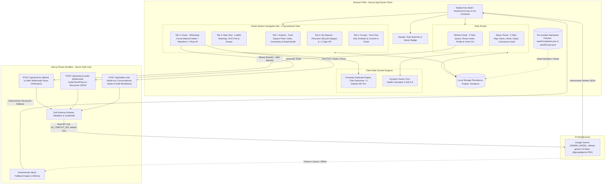

# Plan: Awaaz (آواز)

## 1. Architecture



### Architecture Flow Walkthrough
1. **Client-Side State Engine:** The client runs a hydrated `localStorage` repository pre-seeded with 12 Islamabad municipal records, 5 civic group channels with seeded messages (`seedGroups.json`), and contractor statuses. All status transitions (`REPORTED` → `IN_PROGRESS` → `PENDING_COMMUNITY_VERIFICATION` → `RESOLVED`) append a `history` event. Votes, flat comments, group messages, and `Confirm Fix` happen instantly in client storage. Photos are compressed client-side (`lib/image.ts`, ≤800px JPEG 0.7) before storage.
2. **Harmonized Server-Side AI Gateway:** All AI calls go through Next.js route handlers; keys stay server-side. Responses are validated with Zod, fail closed, and follow `docs/spec.md` §4:
   - `/api/intake-chat`: multi-turn conversational intake (audio/text/photo + `lang` + `history`) returning `{ userTranscript, reply, readyToGenerate }`.
   - `/api/analyze-audio`: Urdu/Roman/English transcript & summaries, fixed `category`, department, urgency, landmark, sector, optional priority breakdown. No coordinates (resolved client-side: GPS → landmark table → sector centre, spec AC-11.3).
   - `/api/verify-fix`: `passed` (decided server-side: verdict VERIFIED_RESOLVED and confidence ≥ 0.60), `confidence` (0.0–1.0), `verdict`, `reasoning`, `detectedChanges`.
3. **Resilience & Fallback Layer:** Each route races Gemini against `AI_TIMEOUT_MS` (default 12000ms; `/api/intake-chat` uses 22000ms). On timeout, missing key, network/5xx error, unparseable output, or `AI_FORCE_FALLBACK=1`, a deterministic `// DEMO-FALLBACK` returns in <300ms with `isOfflineFallback: true`. The audio fallback derives the category from typed-text keywords; the verify fallback rejects an After photo identical to the Before photo. The UI shows the "Offline Mode (Synced locally)" chip.
4. **Test Harness:** Playwright (`e2e/`) runs the golden path against `next start -p 3100` with `AI_FORCE_FALLBACK=1`, so tests are deterministic and make no live AI calls.

---

## 2. Stack Decisions (One Line Rationale Each)

- **Next.js 15 (App Router) + TypeScript (strict):** Unified frontend and serverless API in a single repo with type safety and zero CORS issues.
- **Tailwind CSS v3.4 + Lucide Icons:** Production-grade civic tech dark aesthetic (`civic-*` palette) with fast token-based styling.
- **Vanilla Leaflet (`leaflet`) wrapped in React `useRef`:** Dynamically imported client-side (`ssr: false`) with `L.divIcon()` SVG pins to avoid React 19 peer conflicts and broken marker PNGs.
- **Google Gemini via `@google/genai` (model from `GEMINI_MODEL`, default `gemini-3.5-flash`):** Official SDK handling raw Urdu audio (`inlineData` with dynamic MIME type) and Before/After image comparison. Gemini 2.0 Flash was shut down June 1, 2026 — never use `gemini-2.0-*` / `gemini-2.5-*`.
- **Playwright (`@playwright/test` 1.64.0, Chromium):** Golden-path regression gate for unattended builds; fake media stream flags allow mic/waveform tests.
- **shadcn/ui 2.3.0 (Radix-based, code copied into `components/ui/`):** accessible Dialog/Sheet/Tabs/Dropdown/Switch/Toast with keyboard + focus handling for free. 2.3.0 because the project is on Tailwind v3; theme variables mapped to the `civic-*` palette so the dark look is unchanged; `tailwind-merge` pinned to 2.x.
- **Zod (`zod`):** Enforces strict runtime validation on Gemini structured outputs, guaranteeing schema conformity before UI consumption.
- **Client `localStorage` + Static JSON Seed + Local Assets:** Zero database infrastructure overhead, instantaneous queries, bundled local images in `public/images/hazards/`, and 100% offline conference demo reliability.
- **Web Audio API:** Native browser audio context for the recording waveform visualizer without external libraries.
- **Persistence stays `localStorage`** for now. A shared backend for multi-device demos is OPEN decision D3.

---

## 3. Folder Structure

```text
awaaz/
├── app/
│   ├── api/
│   │   ├── intake-chat/
│   │   │   └── route.ts          # Multi-turn conversational intake chat handler
│   │   ├── analyze-audio/
│   │   │   └── route.ts          # Multimodal Urdu audio/text/photo extraction handler
│   │   └── verify-fix/
│   │       └── route.ts          # Harmonized Before/After Gemini Vision verification handler
│   ├── icon.jpg                  # App icon / favicon from public/logo.jpg (T3.4)
│   ├── manifest.ts               # PWA manifest metadata route → /manifest.webmanifest (T5.2)
│   ├── globals.css               # Tailwind design system, typography & animations
│   ├── layout.tsx                # Mobile-first shell (max-w-md), font setup, metadata
│   └── page.tsx                  # Main application tab & role controller
├── components/
│   ├── ui/                       # shadcn/ui primitives: dialog, sheet, tabs, dropdown-menu, switch, sonner, button, badge, input, textarea (T3.0b)
│   ├── audio/
│   │   └── WaveformVisualizer.tsx# Web Audio API canvas waveform + 0:30 timer (T3.2; MediaRecorder stays in HomeChatIntake)
│   ├── common/
│   │   ├── AppHeader.tsx         # Header: role switcher (5 profiles), language switcher, offline chip, Reset System Data
│   │   ├── BottomNav.tsx         # Symmetrical 5-tab bottom navigation
│   │   ├── ComingSoon.tsx        # Placeholder shell (no longer used by Groups after T4.1)
│   │   ├── LanguageProvider.tsx  # Trilingual EN / Urdu / Roman Urdu context
│   │   └── OfflineBadge.tsx      # "Offline Mode (Synced locally)" badge
│   ├── feed/
│   │   ├── ComplaintCard.tsx     # Rich card with photo, badges, Upvote/Downvote & comments
│   │   ├── ComplaintDetailModal.tsx # Full timeline, Before/After view, audit trail, SLA
│   │   ├── ComplaintFeed.tsx     # Sorted and filtered complaint stream
│   │   ├── FeedFilters.tsx       # Sector and urgency filter chips
│   │   └── CommentSection.tsx    # Flat comments list with Urdu right-to-left support
│   ├── groups/
│   │   ├── GroupsShell.tsx       # Groups tab controller & channel navigation
│   │   ├── GroupChatView.tsx     # Active channel text stream + composer (no voice notes)
│   │   ├── ChatMessageBubble.tsx # Message bubble with 1-tap "Convert to Ticket"
│   │   └── ComplaintCardEmbed.tsx# Interactive complaint ticket embedded in chat
│   ├── home/
│   │   ├── HomeChatIntake.tsx    # Conversational intake (bot avatar, photo upload, mic, triage card)
│   │   └── DuplicateCard.tsx     # In-thread "+1 Impacts Me Too" duplicate prompt
│   ├── map/
│   │   ├── MapView.tsx           # Dynamic SSR-safe Leaflet container with legend
│   │   ├── LeafletMap.tsx        # Leaflet map instance with SVG divIcons
│   │   └── MapDrawer.tsx         # Slide-over preview for clicked hazard pins
│   ├── mayor/
│   │   ├── MayorPortalView.tsx   # 5-tab controller ([Map] [Alerts] [Home] [Depts] [Contractors])
│   │   ├── MayorAlertsTab.tsx    # Critical escalations + Emergency Broadcast form
│   │   └── MayorContractorsTab.tsx # Contractor audit + Freeze/Unfreeze Payout switches
│   ├── reports/
│   │   ├── MyReportsView.tsx     # Citizen's submitted ticket history
│   │   └── LifecycleStepper.tsx  # Reported -> In Progress -> Sign-off -> Resolved
│   └── worker/
│       ├── WorkerPortalView.tsx  # 3-tab controller ([Queue] [Home] [Profile])
│       ├── WorkerQueue.tsx       # Tab 1: Sector pool of open complaints with 1-tap claim
│       ├── WorkerHome.tsx        # Tab 2: Claimed job with route map coordinates
│       ├── BeforeAfterViewer.tsx # Side-by-side Before/After Gemini Vision verification
│       └── WorkerProfile.tsx     # Tab 3: Performance, 98% AI fix accuracy & work ledger
├── lib/
│   ├── ai/
│   │   ├── gemini.ts             # Server-side Gemini client configuration (@google/genai)
│   │   ├── mocks.ts              # Deterministic mock fallbacks (DEMO-FALLBACK)
│   │   ├── prompts.ts            # Urdu triage and vision verification prompts
│   │   ├── schemas.ts            # Zod schemas for structured AI input/output
│   │   └── verification.ts       # Pure verification response normalization & fail-closed rules
│   ├── data/
│   │   ├── landmarks.json        # 12 Islamabad landmarks + 4 sector centres (T4.2)
│   │   ├── seedComplaints.json   # 12 Islamabad fixtures (F-10, F-6, G-9, I-9)
│   │   ├── seedGroups.json       # 5 channels + seeded neighbour messages (T4.1)
│   │   ├── seedContractors.json  # Contractor list + payout status (T4.3)
│   │   └── storage.ts            # Hydration-safe localStorage helpers; appends history events; quota-safe writes
│   ├── types.ts                  # Shared TypeScript interfaces (spec §3)
│   ├── categories.ts             # Fixed category table: department, default urgency, titles, stock photo, keywords (T3.1)
│   ├── i18n.ts                   # Trilingual EN / Urdu / Roman Urdu translations
│   ├── image.ts                  # Client-side photo compression ≤800px JPEG 0.7 (T3.2)
│   ├── labels.ts                 # Urgency, department, and status badges/colors
│   └── utils.ts                  # cn() class merger (shadcn), Haversine distance (T4.2), civic health calculator (T4.4)
├── e2e/
│   └── golden-path.spec.ts       # Playwright golden-path smoke test (T3.0) + feature tests
├── playwright.config.ts          # Chromium, 390×844, next start -p 3100, AI_FORCE_FALLBACK=1
├── components.json               # shadcn config (new-york, neutral, cssVariables)
├── .npmrc                        # save-exact=true, legacy-peer-deps=true (T3.0b)
├── public/
│   ├── logo.jpg
│   ├── icons/                    # PWA icons 192/512 (T5.2)
│   └── images/
│       └── hazards/              # Local Before/After hazard photos
├── docs/
│   ├── brief.md
│   ├── spec.md
│   ├── plan.md
│   ├── tasks.md
│   └── progress.md
├── AGENTS.md
├── package.json
├── tsconfig.json
├── tailwind.config.ts
└── next.config.mjs
```

---

## 4. Key Contracts & Interfaces

### 4.1 Harmonized AI Verification Contracts (`lib/ai/schemas.ts`)

```typescript
import { z } from "zod";

// What the MODEL must return. Fail closed: no defaults or catches that could produce a pass.
// Any parse failure → deterministic DEMO-FALLBACK with isOfflineFallback: true.
export const ModelVerificationSchema = z.object({
  verdict: z.enum(["VERIFIED_RESOLVED", "REJECTED_UNRESOLVED"]),
  /** Model may slip into 0–100; normalizeConfidence() divides by 100 once if 1 < value ≤ 100. */
  confidence: z.number(),
  reasoning: z.string().min(1),
  detectedChanges: z.array(z.string()).default([]),
});

export const PASS_CONFIDENCE = 0.6;

// What the ROUTE returns (docs/spec.md §4.2). `passed` is computed server-side only:
// passed = verdict === "VERIFIED_RESOLVED" && confidence >= PASS_CONFIDENCE
export interface FixVerificationResponse {
  passed: boolean;
  confidence: number; // 0.0–1.0
  verdict: "VERIFIED_RESOLVED" | "REJECTED_UNRESOLVED";
  reasoning: string;
  detectedChanges: string[];
  timestamp: string;
  complaintId: string;
  isOfflineFallback: boolean;
}
```
No `verified`, `explanation`, or `fallback` fields anywhere.

---

## 5. Deployment & Execution Strategy

- **Local Development:** `npm run dev` (run at `http://localhost:3000`).
- **Production Build:** `npm run build` (must pass with 0 errors before any task is completed).
- **Lint:** `npm run lint` (must pass).
- **E2E:** `npm run test:e2e` — Playwright against `next start -p 3100` with `AI_FORCE_FALLBACK=1` (needs a prior build).
- **Evaluations:** deferred (decision D4).

---

## 6. Two Key Risks & Mitigations

### Risk 1: Venue Network Drop / Gemini API Rate Limit
- **Impact:** Live Urdu voice recording or worker Before/After photo submission hangs during judging.
- **Mitigation:** `Promise.race` timeout (`AI_TIMEOUT_MS`, default 5000ms) falling back to deterministic, input-aware mock JSON (<300ms) paired with an honest "Offline Mode (Synced locally)" badge.

### Risk 3: localStorage Quota (~5MB)
- **Impact:** A single uncompressed phone photo (3–5MB as base64) can fill storage and crash writes.
- **Mitigation:** Compress every stored photo via `lib/image.ts` (≤800px, JPEG 0.7 ≈ 60–120KB) and catch `QuotaExceededError` with a friendly "use Reset System Data" message.

### Risk 2: Leaflet Window Object SSR Crash & Marker 404s
- **Impact:** `ReferenceError: window is not defined` or broken marker image icons.
- **Mitigation:** Vanilla `leaflet` dynamically imported with `{ ssr: false }`, rendered exclusively via `L.divIcon()` with inline SVG templates.
